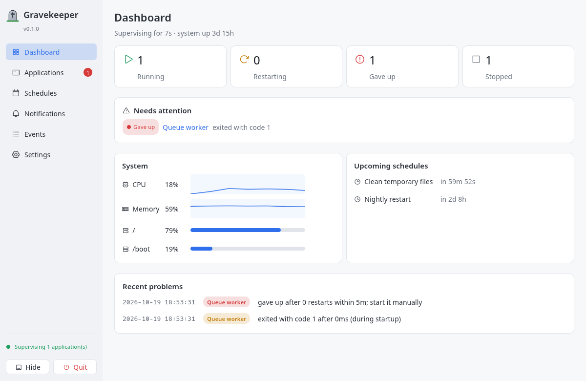
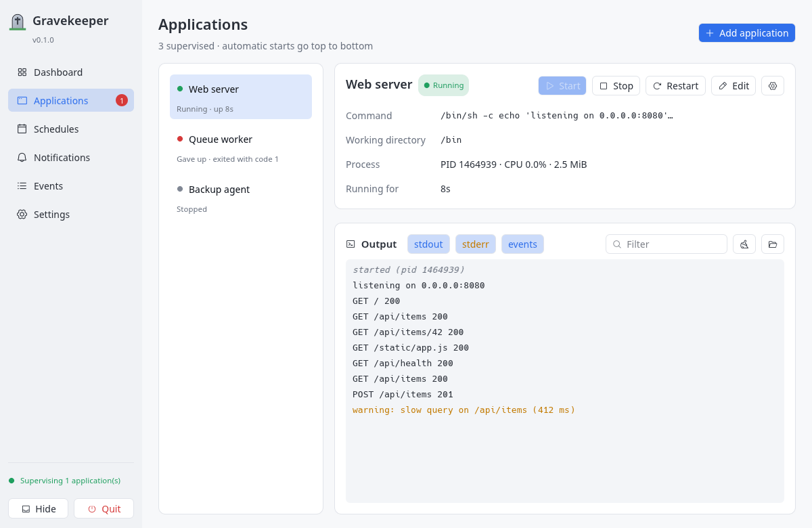
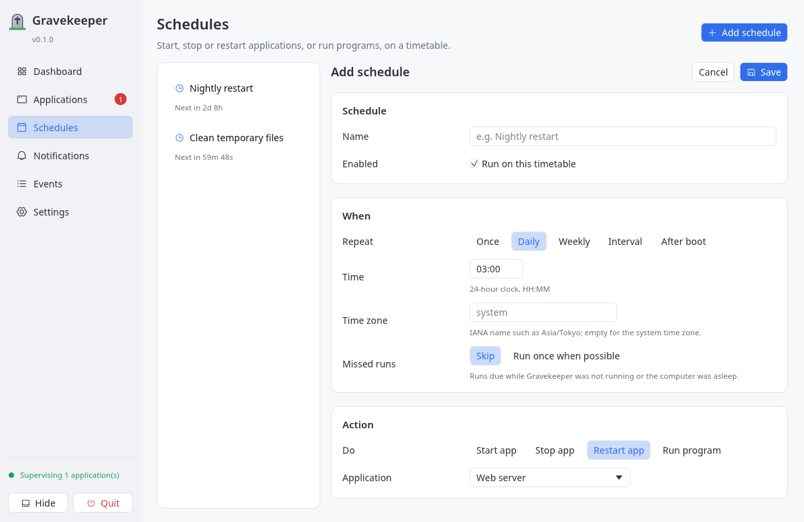
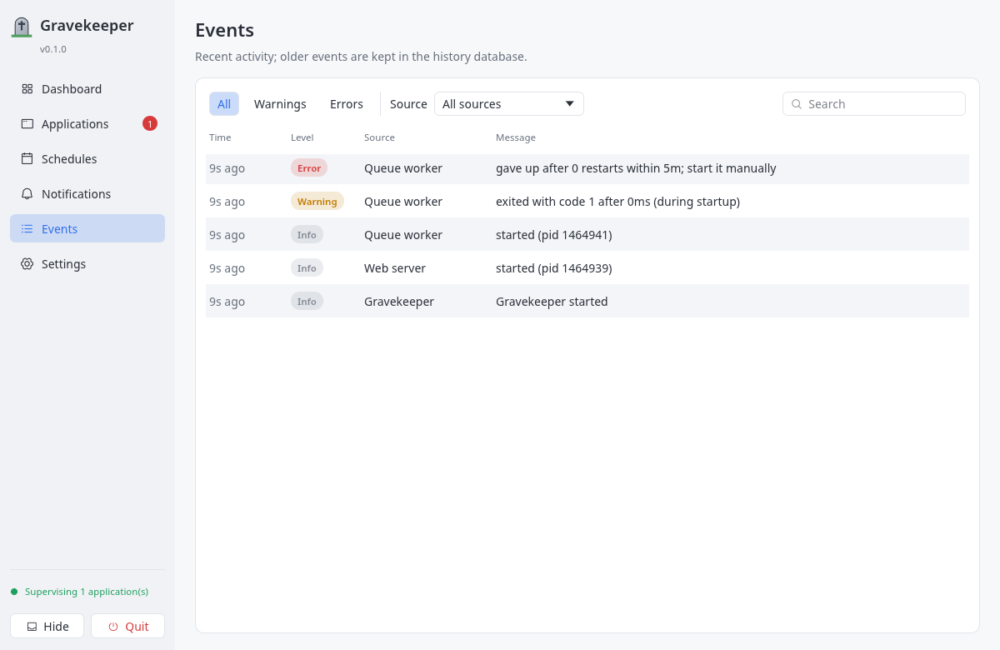

# Gravekeeper

A desktop tool for supervising and operating applications on Windows, macOS and Linux:
start/stop/restart processes, capture their output, detect crashes, restart with back-off,
run schedules and send webhook notifications. Written in Rust with an [egui] GUI.

> **Status:** Phase 3. Applications are supervised with automatic restarts and start in a
> defined order; schedules run actions on a timetable; webhooks report crashes, failed
> schedules and resource alerts; CPU, memory and disks are monitored. It runs as a tray
> application or headless as a user service, and installers are built for all three OSes.
> Linux is tested on real hardware; Windows and macOS are built and tested in CI only.
> See [the implementation plan](docs/implementation-plan.md).

<picture>
  <source media="(prefers-color-scheme: dark)" srcset="docs/images/dashboard-dark.png">
  
</picture>

<table>
  <tr>
    <td width="33%" valign="top">
      <picture>
        <source media="(prefers-color-scheme: dark)" srcset="docs/images/applications-dark.png">
        
      </picture>
      <p align="center">Applications and their live output</p>
    </td>
    <td width="33%" valign="top">
      <picture>
        <source media="(prefers-color-scheme: dark)" srcset="docs/images/schedule-editor-dark.png">
        
      </picture>
      <p align="center">Schedules</p>
    </td>
    <td width="33%" valign="top">
      <picture>
        <source media="(prefers-color-scheme: dark)" srcset="docs/images/events-dark.png">
        
      </picture>
      <p align="center">Event history</p>
    </td>
  </tr>
</table>

Screenshots follow your light or dark preference; the app has both themes.

## Installing

Download a package from the releases (`.deb`, `.AppImage`, Windows `-setup.exe`, macOS `.dmg`),
or build one yourself — see [docs/distribution.md](docs/distribution.md). On Linux without a
package, `packaging/linux/install.sh` installs a release build into `~/.local`.

## Usage

```sh
gravekeeper                     # open the GUI (lives in the system tray)
gravekeeper --minimized         # start with only the tray icon
gravekeeper --headless          # supervise without a GUI
gravekeeper service install     # run headless as a user service (Linux, macOS)
```

Applications, schedules, webhooks and monitoring are configured in the GUI or in
[`config.toml`](docs/configuration.md).

## Layout

| Path | Contents |
|---|---|
| `crates/gravekeeper-core` | Supervisor engine. No GUI dependency; talks to front-ends only through `CoreHandle`. |
| `crates/gravekeeper` | Desktop application (eframe window, system tray). |
| `packaging/` | Icons, Linux desktop entry template and install script. |
| `docs/` | [Architecture](docs/architecture.md), [configuration](docs/configuration.md), [distribution](docs/distribution.md), [plan](docs/implementation-plan.md), [platform notes](docs/platform-support.md), [building](docs/building.md). |

## Building

Requires Rust 1.95 or newer. See [docs/building.md](docs/building.md) for platform packages.

```sh
cargo run -p gravekeeper            # debug build of the GUI
cargo test --workspace              # all tests
cargo build --release -p gravekeeper
```

## License

[MIT](LICENSE)

[egui]: https://github.com/emilk/egui
